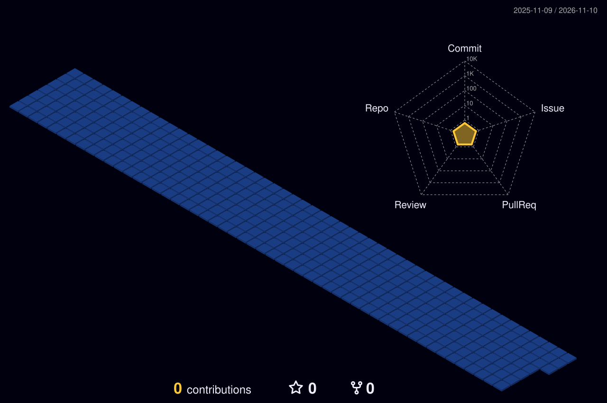

<!-- Banner hidden for now. Delete this comment wrapper to show it again.
<picture>
  <source media="(prefers-color-scheme: dark)" srcset="./banner.svg?v=2">
  <source media="(prefers-color-scheme: light)" srcset="./banner-light.svg?v=2">
  
</picture>
-->

  

  

  

  

### `$ ls ~/projects`

<table>
  <tr><th>Project</th><th>What it is</th><th>Stack</th></tr>
  <tr><td><b>Mobility platform</b></td><td>Rider and driver apps, admin and super-admin panels, backend and website</td><td>Flutter · TypeScript · Node.js</td></tr>
  <tr><td><b>Creator platform</b></td><td>Creator discovery and outreach: web app, admin and finance panels</td><td>TypeScript · React</td></tr>
  <tr><td><b>3D warehouse dashboard</b></td><td>Isometric warehouse operations view</td><td>React Three Fiber · Three.js</td></tr>
  <tr><td><b>E-commerce storefront</b></td><td>Storefront with WebGL product viewers</td><td>Next.js · Tailwind · WebGL</td></tr>
  <tr><td><b>Job portal</b></td><td>Job search, match scores, application tracker, tailored CVs</td><td>TypeScript · React</td></tr>
  <tr><td><b>Animated video slides</b></td><td>Programmatic motion videos</td><td>React · Remotion</td></tr>
</table>

<a href="https://github.com/MuhammadUsama-Ashraf?tab=repositories"><b>→ See all 74 repositories</b></a>

  

<!-- Snake hidden for now. Delete this comment wrapper to show it again.
### `$ git log --graph`

<picture>
  <source media="(prefers-color-scheme: dark)" srcset="https://raw.githubusercontent.com/MuhammadUsama-Ashraf/MuhammadUsama-Ashraf/output/github-contribution-grid-snake-dark.svg">
  <source media="(prefers-color-scheme: light)" srcset="https://raw.githubusercontent.com/MuhammadUsama-Ashraf/MuhammadUsama-Ashraf/output/github-contribution-grid-snake.svg">
  
</picture>

_generated with [Platane/snk](https://github.com/Platane/snk)_

  
-->

<!-- 3D city hidden for now. Delete this comment wrapper to show it again.
### `$ ./contribution-city`

*Every commit adds a building. Rebuilt automatically every day.*

  
-->

<!-- Metrics hidden for now. Delete this comment wrapper to show it again.
### `$ metrics --all`

  
-->

<!-- GitHub badge hidden for now. Delete this comment wrapper to show it again.
  

-->
<!-- Add your links, then delete this comment wrapper:

-->

<!-- Visitor counter and sign-off hidden for now. Delete this comment wrapper to show it again.
  

  

**keep coding, keep growing.**
-->

